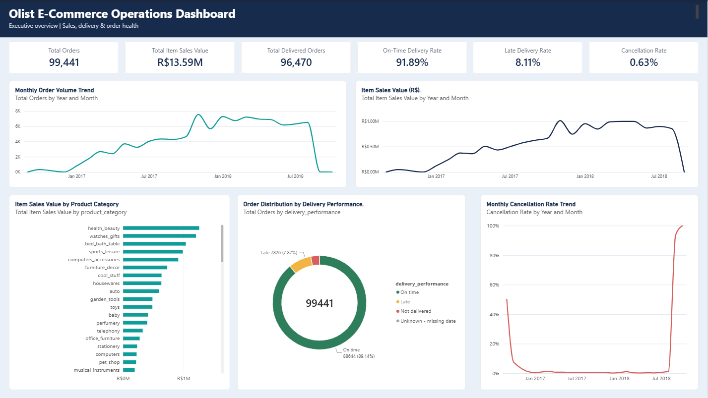

# Olist E-Commerce Operations Analytics

**MySQL + Power BI | Operations Analytics Portfolio Project**

A two-page Power BI report examining order volume, item sales value, delivery punctuality, fulfilment time and cancellations using the [Brazilian E-Commerce Public Dataset by Olist](https://www.kaggle.com/datasets/olistbr/brazilian-ecommerce). SQL supports data-quality investigation, business analysis and two reusable reporting views.

## Dashboard previews

### Executive Overview


### Delivery & Fulfilment


## Key findings

| Metric | Validated result |
|---|---:|
| Total orders | 99,441 |
| Delivered orders with classified punctuality | 96,470 |
| On-time delivered orders | 88,644 |
| Late delivered orders | 7,826 |
| On-time delivery rate | 91.89% |
| Late delivery rate | 8.11% |
| Item sales value (excluding freight) | R$13,591,643.70 |
| Freight value | R$2,251,909.54 |
| Average delivery duration | 12.50 days |

**Definitions matter:** Item sales value is the sum of item prices, excluding freight; it is not profit or recognised revenue. The on-time/late rates use the eligible delivered-order baseline. Eight additional delivered-status orders lack customer-delivery timestamps; they are separately flagged as unknown in the order-level view.

November 2017 had the highest monthly order count (7,544 orders). Top categories by item value include Health & Beauty, Watches & Gifts and Bed, Bath & Table. These are descriptive findings, not causal explanations.

## Business Questions & Answers

| Business question | Findings from the analysis |
|---|---|
| **1. How do orders and item sales value change over time?** | November 2017 recorded the highest monthly order volume: **7,544 orders**, with approximately **R$1.01 million** in item sales value. Monthly demand and item value varied across the observed period; the peak alone does not establish a recurring seasonal pattern. |
| **2. Which product categories contribute the most item value?** | **Health & Beauty** led with **R$1,258,681.34**, followed by **Watches & Gifts** (**R$1,205,005.68**), **Bed, Bath & Table** (**R$1,036,988.68**), **Sports & Leisure** (**R$988,048.97**) and **Computers & Accessories** (**R$911,954.32**). These figures exclude freight and do not measure profitability. |
| **3. How frequently are delivered orders on time?** | Of **96,470** delivered orders with classified punctuality, **88,644 (91.89%)** were on time and **7,826 (8.11%)** were late. An additional **8** delivered-status orders had missing delivery timestamps and were classified separately. |
| **4. How long does fulfilment take, and how does it vary by month?** | Average delivery duration was **12.50 days**. Monthly performance varied: **March 2018** recorded **78.64%** on-time delivery and **1,496** late deliveries, while **June 2018** recorded **98.64%** on-time delivery. **August 2018** averaged **7.66 days** but had **89.61%** on-time delivery, illustrating that speed and punctuality are different measures. |
| **5. What do purchase-month cancellation cohorts show?** | The analysis calculates cancellation rates by **purchase month using each order's current status**. These are cohort comparisons, **not historical month-end cancellation rates**. Sparse late-period cohorts, especially September and October 2018, should not be interpreted as reliable trends. The available validated summary does not establish a single defensible peak cancellation month. |
| **6. Which data-quality exceptions require careful interpretation?** | **8** delivered-status orders have missing customer-delivery timestamps, and **6** cancelled-status orders have delivery timestamps. The model also distinguishes order-level and item-level grains to avoid inflated order counts from joins. |

These are descriptive findings. See [Insights and recommendations](INSIGHTS_AND_RECOMMENDATIONS.md) and [Methodology and limitations](METHODOLOGY_AND_LIMITATIONS.md) for interpretation and follow-up investigation priorities.

## Tech stack and architecture

- **MySQL 8.0.46:** imported Olist tables, validation queries, reconciliations, analytical views.
- **Power BI Desktop (Import):** two reporting pages using the analytical views.
- **Order-level view:** `vw_order_level_analytics` (one row per order).
- **Item-level view:** `vw_order_item_analytics` (one row per order item).
- **Relationship:** order-level `order_id` (one) → item-level `order_id` (many).

## Repository structure

```text
├── README.md
├── PROJECT_DOCUMENTATION.md
├── DATA_DICTIONARY.md
├── METHODOLOGY_AND_LIMITATIONS.md
├── INSIGHTS_AND_RECOMMENDATIONS.md
├── .gitignore
├── SQL/
│   ├── Olist_Consolidated_SQL_Reference.sql
│   └── Olist_Consolidated_SQL_Annotated.md
├── Screenshots/
│   ├── Dashboard_Executive_Overview.png
│   └── Dashboard_Delivery_&_Fulfilment.png
└── PowerBI/
    └── Olist_Ecommerce_Operations_Dashboard.pbix
```

The Power BI Desktop file is stored in `PowerBI/` in the published repository.

## Reproduction

1. Obtain the Olist dataset from the linked source and import the nine tables into MySQL schema `ecommerce_analytics`.
2. Review `SQL/Olist_Consolidated_SQL_Reference.sql`; it assumes the raw tables are already imported. Running it executes exploratory SELECTs and creates/replaces the two analytical views.
3. Open `PowerBI/Olist_Ecommerce_Operations_Dashboard.pbix` in Power BI Desktop.
4. Update the MySQL connection/credentials for your environment, refresh, and verify the one-to-many order relationship.
5. Reconcile the key figures above; consult the methodology notes for eligibility and timestamp exceptions.

## Documentation

- [Project documentation](PROJECT_DOCUMENTATION.md)
- [Data dictionary](DATA_DICTIONARY.md)
- [Methodology and limitations](METHODOLOGY_AND_LIMITATIONS.md)
- [Insights and recommendations](INSIGHTS_AND_RECOMMENDATIONS.md)
- [Consolidated SQL](SQL/Olist_Consolidated_SQL_Reference.sql)
- [Annotated SQL walkthrough](SQL/Olist_Consolidated_SQL_Annotated.md)

## Important limitations

- Monthly cancellation rates use **current status grouped by purchase month**, not historical month-end status snapshots.
- Eight delivered orders lack a customer-delivery timestamp; six cancelled orders have delivery timestamps.
- September and October 2018 contain very few orders and should not be treated as representative full months.
- Analyses are observational; the dataset does not by itself establish why an operational change occurred.
- No credentials, raw CSV dataset, or automatic refresh service are included.
